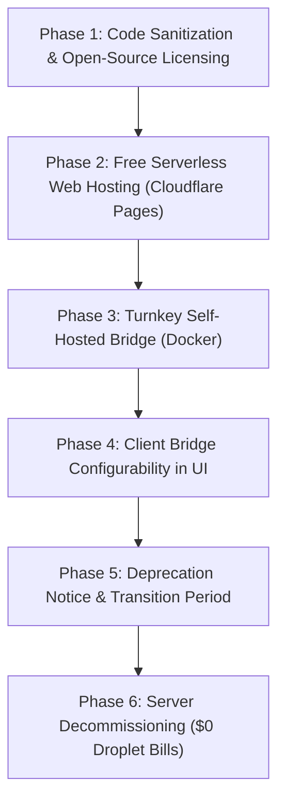

# Plan: Graceful Open-Sourcing and Server Retirement for VoltMiner Web

This document outlines the step-by-step strategy to open-source the `voltminer-web` frontend and `web-stratum-bridge`, enable turnkey community self-hosting, and safely decommission the personal DigitalOcean server (`137.184.209.157`) with zero ongoing financial liability and zero surprise failures.

---

## 1. Current Infrastructure & Server Dependencies

Currently, the droplet (`137.184.209.157`) performs two distinct functions:

| Component | Responsibility | Technical Requirement | Droplet Retirement Hurdle |
| :--- | :--- | :--- | :--- |
| **Static Web App** (`web.voltminer.net`) | Serves HTML, JS, CSS, and RandomX Wasm binaries. | Requires `Cross-Origin-Opener-Policy: same-origin` and `Cross-Origin-Embedder-Policy: require-corp` (COOP/COEP) headers to enable `SharedArrayBuffer` for multithreading. | GitHub Pages does not support custom headers natively. Standard static hosts will disable multithreading unless headers are configured. |
| **Stratum Bridge** (`bridge.voltminer.net` / `/stratum`) | Stateful Node.js WebSocket-to-TCP daemon (`tools/web-stratum-bridge/server.mjs`) proxying to `gulf.moneroocean.stream:20032`. | Browsers cannot open raw TCP sockets; they must connect over WSS. The bridge maintains live TCP sockets to the mining pool. | Cannot run on serverless/static hosting. Must run as a persistent container or daemon. |

---

## 2. Target State Architecture (Zero Server Maintenance)

1. **Website Hosting**:
   - **Primary Option (Zero Cost)**: **Cloudflare Pages**.
     - Completely free forever.
     - Automated git deployments directly from the public GitHub repository.
     - Custom headers supported via a single `_headers` file in the repo root (giving full COOP/COEP and `SharedArrayBuffer` support without any server).
     - Can use `web.voltminer.net` custom domain or `*.pages.dev`.
   - **Alternative (Local / Community)**: 1-click Docker Compose running Caddy with built-in headers.

2. **Stratum Bridge Hosting**:
   - **Community / Self-Hosted**: Package the bridge into a container (`Dockerfile` + `docker-compose.yml`) so anyone can run it on a \$2-3 VPS, Raspberry Pi, home server, or free-tier container platforms (Railway, Render, Fly.io).
   - **UI Bridge Selector**: Update `miner-client.js` and `index.html` to allow users to specify custom bridge endpoints or select from known community bridges, rather than relying strictly on `wss://bridge.voltminer.net`.

3. **Licensing & Legal Hygiene**:
   - Replace proprietary notice in `notices.html` and `index.html` with an open-source license (MIT or BSD-3-Clause to match RandomX).
   - Provide an official `LICENSE` file in the repository root.

---

## 3. Step-by-Step Retirement & Open-Source Roadmap



---

### Phase 1: Code Sanitization & Open-Source Licensing
* **Remove Proprietary Claims**:
  - Update [`notices.html`](file:///Users/jerry/Developer/voltminer-web/notices.html): replace *"The HTML, CSS, JavaScript and worker code ... are proprietary; no licence is granted"* with the chosen open-source license terms.
  - Update footer text in [`index.html`](file:///Users/jerry/Developer/voltminer-web/index.html).
  - Add [`LICENSE`](file:///Users/jerry/Developer/voltminer-web/LICENSE) file (recommended: **MIT** or **BSD-3-Clause**).
* **Decouple Hardcoded VPS Configurations**:
  - Make `origin.mjs` in the bridge support wildcard or environment-driven allowlists (`BRIDGE_ALLOWED_ORIGINS=*` or comma-separated list), so third-party operators can host the bridge without editing code.
  - Parameterize `tools/deploy.sh` so personal server IPs are not hardcoded as defaults.

---

### Phase 2: Decouple Website to Free Serverless Hosting (Cloudflare Pages)
* **Add Cloudflare `_headers`**:
  Create `_headers` in the project root:
  ```http
  /*
    Cross-Origin-Opener-Policy: same-origin
    Cross-Origin-Embedder-Policy: require-corp
    Cross-Origin-Resource-Policy: same-origin
    Content-Security-Policy: default-src 'none'; script-src 'self' 'wasm-unsafe-eval'; style-src 'self'; style-src-attr 'unsafe-inline'; img-src 'self' data:; font-src 'self'; connect-src 'self' wss:; manifest-src 'self'; worker-src 'self' blob:;
  ```
  *(Note: `connect-src 'self' wss:` allows connecting to self-hosted stratum bridges across different domains).*
* **Connect Repository to Cloudflare Pages**:
  - Build settings: Static (no build command, output directory: `/`).
  - Cost: **\$0/month forever**, handles global CDN and high traffic with zero maintenance.

---

### Phase 3: Package Turnkey Bridge (Docker & Cloud Deploy)
* **Create Standalone Bridge Container**:
  - Add `tools/web-stratum-bridge/Dockerfile` (lightweight Node.js alpine container).
  - Add root `docker-compose.yml` for users who want to run both Caddy and the bridge with one command:
    ```bash
    docker compose up -d
    ```
* **Add 1-Click Deploy Buttons**:
  - Provide instructions / templates for deploying the bridge to Fly.io, Railway, or Render.

---

### Phase 4: UI Support for Custom / Self-Hosted Bridges
* **Current Limitation**:
  `miner-client.js` currently defaults to `wss://bridge.voltminer.net` unless overridden via URL parameter `?relay=...`.
* **Improvement**:
  - Add an optional "Bridge Settings" collapsible in `index.html`:
    - Presets: "Self-Hosted Local (`ws://localhost:8787`)", "Custom WebSocket URL", or "Default".
    - Store the user's custom bridge preference in `localStorage`.
  - When the default droplet bridge is retired, users or communities can seamlessly point to their own bridge without URL hacking.

---

### Phase 5: Deprecation Notice & Transition Period (e.g. 14 Days)
* **Publish Transition Banner on `web.voltminer.net`**:
  - Inform users that the project is now 100% open-source and transitioning to community self-hosting / static hosting.
  - Link to GitHub repository setup guide.
* **Repoint DNS**:
  - Point `web.voltminer.net` CNAME to the Cloudflare Pages instance.

---

### Phase 6: Server Teardown (DigitalOcean Decommissioning)
* **Check Inactive Connections**:
  - Verify bridge logs (`journalctl -u web-stratum-bridge`) to ensure no persistent miners remain dependent on the droplet.
* **Stop Services & Destroy Droplet**:
  - Stop systemd services: `systemctl stop caddy web-stratum-bridge`.
  - Delete droplet `137.184.209.157` on DigitalOcean.
* **Remove / Update Stale DNS Records**:
  - Delete `A` record for `bridge.voltminer.net`.
  - Retain domain `voltminer.net` at registrar level if desired, or let subdomains point to Cloudflare Pages.

---

## 4. Immediate Decision Points for You

Before executing the implementation steps, please confirm:
1. **License Choice**: Do you prefer **MIT** (simple, permissive), **BSD-3-Clause** (matches upstream RandomX), or **AGPLv3** (strong copyleft)?
2. **Domain Future (`voltminer.net`)**:
   - Would you like `web.voltminer.net` to stay live for free on Cloudflare Pages?
   - Or would you prefer pointing the domain directly to the GitHub repository / letting it redirect?
3. **Timeline**: Would you like to stage the open-source files and Docker templates immediately in this session?
