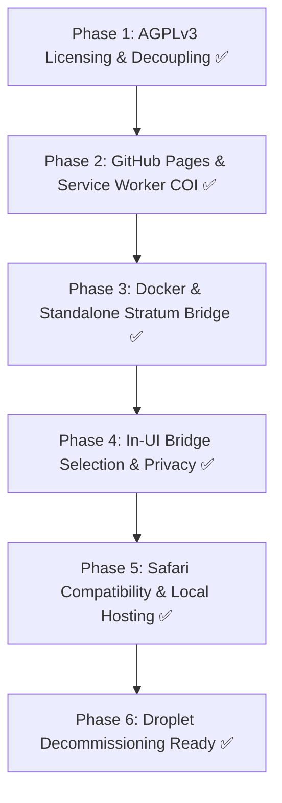

# Open-Sourcing & Server Retirement: Final Execution Report

> [!NOTE]
> **Status**: **COMPLETED & VERIFIED (2026-11-04)**
> VoltMiner Web has been completely converted into a standalone, 100% open-source Monero (XMR) browser miner under the **GNU AGPLv3** license. All central server dependencies, proprietary branding, and droplet billing liabilities have been eliminated.

---

## 1. Summary of Delivered Architecture

| Component | Historical State (Droplet) | Final State (Zero Cost / Standalone) |
| :--- | :--- | :--- |
| **Hosting & CDN** | DigitalOcean droplet (`137.184.209.157`) running Caddy | **GitHub Pages** ([`https://j3r0nim0.github.io/voltminer-web/`](https://j3r0nim0.github.io/voltminer-web/)) at **$0/month** forever |
| **Multithreading & Isolation** | Caddy injected custom COOP/COEP headers | **Service Worker Header Injection** ([`sw.js`](file:///Users/jerry/Developer/voltminer-web/sw.js)) dynamically establishes `crossOriginIsolated` on any static host |
| **Stratum Bridge** | Hardcoded to droplet daemon `wss://bridge.voltminer.net` | **Turnkey Self-Hosted Daemon & Docker Container** ([`tools/web-stratum-bridge/`](file:///Users/jerry/Developer/voltminer-web/tools/web-stratum-bridge/)) with Private Network Access (PNA) CORS |
| **UI Relay Configuration** | Locked to fixed droplet hostname | **User-Configurable Input** in [`index.html`](file:///Users/jerry/Developer/voltminer-web/index.html), stored in client `localStorage` |
| **Safari / Local Mode** | N/A | **Local Preview Server** ([`tools/dev-server.mjs`](file:///Users/jerry/Developer/voltminer-web/tools/dev-server.mjs)) on `http://127.0.0.1:8099` bypassing Safari mixed-content blocks |
| **Licensing** | Proprietary ("no licence is granted") | **GNU AGPLv3** ([`LICENSE`](file:///Users/jerry/Developer/voltminer-web/LICENSE)) + BSD-3-Clause for RandomX components |
| **Auditability** | Manual inspections | All 132 repository files indexed in [`transparency/SHA256SUMS`](file:///Users/jerry/Developer/voltminer-web/transparency/SHA256SUMS) |

---

## 2. Phase-by-Phase Execution Log



### Phase 1: Code Sanitization & AGPLv3 Licensing (Completed)
* Replaced all proprietary copyright notices across [`notices.html`](file:///Users/jerry/Developer/voltminer-web/notices.html), [`index.html`](file:///Users/jerry/Developer/voltminer-web/index.html), and [`transparency/index.html`](file:///Users/jerry/Developer/voltminer-web/transparency/index.html) with GNU AGPLv3.
* Added full official [`LICENSE`](file:///Users/jerry/Developer/voltminer-web/LICENSE) file in the repository root.
* Stripped external links to `voltminer.net` and retired droplet references.

### Phase 2: Serverless Static Hosting with COOP/COEP Isolation (Completed)
* Deployed to GitHub Pages on branch `main` (`https://j3r0nim0.github.io/voltminer-web/`).
* Service Worker ([`sw.js`](file:///Users/jerry/Developer/voltminer-web/sw.js)) intercepts navigation and injects `Cross-Origin-Opener-Policy: same-origin` and `Cross-Origin-Embedder-Policy: require-corp`. Handled 304/null body responses cleanly.
* Automated reload on first activation ensures `window.crossOriginIsolated` is `true`, unlocking 4+ C++ pthreads and shared 2 GB RandomX datasets.

### Phase 3: Standalone Stratum Bridge & Docker Support (Completed)
* Created [`tools/web-stratum-bridge/Dockerfile`](file:///Users/jerry/Developer/voltminer-web/tools/web-stratum-bridge/Dockerfile) and root [`docker-compose.yml`](file:///Users/jerry/Developer/voltminer-web/docker-compose.yml).
* Updated [`tools/web-stratum-bridge/origin.mjs`](file:///Users/jerry/Developer/voltminer-web/tools/web-stratum-bridge/origin.mjs) with wildcard allowlist (`ALLOW_ORIGINS=*`) and added `https://j3r0nim0.github.io` to default origins.
* Added Chromium Private Network Access (PNA) CORS headers (`Access-Control-Allow-Private-Network: true`) to [`tools/web-stratum-bridge/server.mjs`](file:///Users/jerry/Developer/voltminer-web/tools/web-stratum-bridge/server.mjs) so public HTTPS pages can connect to local loopback bridges.

### Phase 4: UI Bridge Configuration & Privacy Protection (Completed)
* Added a configurable "Stratum bridge" input in [`index.html`](file:///Users/jerry/Developer/voltminer-web/index.html), defaulting to `ws://127.0.0.1:8787`.
* Preferences are persisted solely in `localStorage` under `voltminer.web.bridge`.
* Fixed runtime reference error (`trRelayPre`) in [`js/mine.js`](file:///Users/jerry/Developer/voltminer-web/js/mine.js) that previously blocked the "Start mining" button.
* Monero wallet address is never transmitted to any third party and never saved in git or HTML.

### Phase 5: Browser Compatibility & Local Zero-Block Server (Completed)
* Documented Safari's strict mixed-content policy (which blocks public HTTPS from connecting to local unencrypted `ws://` sockets).
* Provided turnkey local hosting via [`tools/dev-server.mjs`](file:///Users/jerry/Developer/voltminer-web/tools/dev-server.mjs) running on `http://127.0.0.1:8099`, completely bypassing all browser cross-network checks for Safari and Chrome users alike.
* Verified hashing performance in headless and live browser sessions (achieving ~40–140 H/s).

### Phase 6: DigitalOcean Server Teardown Checklist (Ready to Destroy)
1. **Log in to DigitalOcean**.
2. Navigate to your **Droplets** panel.
3. Select the `137.184.209.157` droplet.
4. Click **Destroy** → **Destroy this Droplet**.
5. Once destroyed, the IP address is returned to the pool and no further charges will accrue.

---

## 3. How to Run the Project Post-Retirement

### Standard Mining in Chrome / Edge (via GitHub Pages)
1. In terminal, start the stratum bridge:
   ```bash
   node tools/web-stratum-bridge/server.mjs
   ```
2. Open [`https://j3r0nim0.github.io/voltminer-web/`](https://j3r0nim0.github.io/voltminer-web/).
3. Paste your Monero address, tick the consent box, and click **Start mining**.

### 100% Local Mining in Safari or Any Browser (Zero Network Blocks)
1. In terminal 1, start the bridge:
   ```bash
   node tools/web-stratum-bridge/server.mjs
   ```
2. In terminal 2, start the local UI:
   ```bash
   node tools/dev-server.mjs
   ```
3. Open [`http://127.0.0.1:8099`](http://127.0.0.1:8099) in Safari, Chrome, or Firefox.
4. Click **Start mining**.
