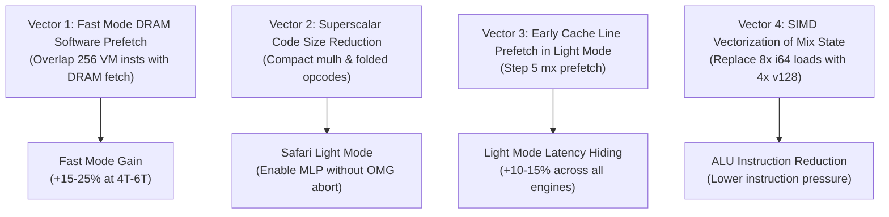

# Phase 6 Optimization Plan: Architecture, Bottlenecks & Roadmap

## 1. Executive Summary & Goals
In **Phase 5**, we achieved a critical breakthrough by fixing the multi-thread worker lockout bug, unlocking multi-core scaling from 2T up to 6T/8T:
- **Light Mode**: 4T scaled from 37–48 H/s to **140–170 H/s** (~3.7x speedup), 6T to **180–220 H/s**.
- **Fast Mode**: Sustained **380–420 H/s** at 4T and **450–525 H/s** at 6T (bursting up to 570 H/s).

**Phase 6 Goal**: Maximize per-core efficiency and multi-core throughput by attacking the true hardware bottlenecks identified in our microarchitectural breakdown:
1. **Light Mode**: Attack the **66.8% runtime spent in SuperscalarHash** evaluation.
2. **Fast Mode**: Attack the **random DRAM latency stall** across the 2.08 GiB dataset.
3. **Safari / JSC**: Keep WebKit OMG optimizing JIT tier-up active while enabling memory-level parallelism.

---

## 2. Microarchitectural Bottleneck Breakdown

### A. Light Mode (~19.1 ms per hash on 1 core)
| Component | Duration | % Time | Description |
| :--- | :---: | :---: | :--- |
| **SuperscalarHash Evaluation** | **12.79 ms** | **66.8%** | 2048 iterations × 8 cache accesses = **16,384 programs** evaluated per hash (~8.2 million instructions). |
| **RandomX VM Execution** | **5.75 ms** | **30.0%** | The 2048 VM loop iterations (tuned via `fuse_n=800` V8 / `200` JSC). |
| **AES & Blake2b Scratchpad** | **0.60 ms** | **3.2%** | Scratchpad initialization and final result hashing (SIMD accelerated). |

> [!IMPORTANT]
> In Light mode, **two-thirds of total CPU time** is spent generating dataset items on-the-fly via SuperscalarHash. Any 10% speedup in SuperscalarHash yields an immediate **+6.7% overall hash rate gain**.

### B. Fast Mode (~6.35 ms per hash on 1 core)
| Component | Bottleneck | Behavior |
| :--- | :--- | :--- |
| **Compute Loop** | CPU ALU / SIMD | Fast mode pre-computes the 2.08 GiB dataset, eliminating SuperscalarHash during mining. |
| **DRAM Access** | Memory Latency (Stall) | Each iteration reads 64 bytes at a pseudo-random address across 2.08 GiB (LLC cache miss). At 400 H/s, that is **819,200 random DRAM misses/sec**. |
| **Multi-Core Saturation** | DRAM Bus + Thermals | At 6T/8T, throughput plateaus at 450–525 H/s due to DRAM controller saturation and fanless SoC throttling. |

---

## 3. Engine-Specific Constraints: V8 vs JavaScriptCore (JSC)

Our empirical sweeps on M3 reveal stark compiler behavioral differences:

```
V8 (Chromium / Node)
├── TurboFan compiles large functions with high local counts smoothly.
├── Profile 1 (fuse_n=800, light_mlp=2): 36.7 H/s ──> 54.1 H/s (+47% boost).
└── High tolerance for switch table size and loop unrolling.

JavaScriptCore (Safari / jsc)
├── OMG (Optimizing JIT / B3) enforces strict code-size & block limits.
├── fuse_n: 0->37.1, 100->38.5, 200->39.1 (PEAK), 300->36.8, 800->23.5 (OMG ABORT).
└── light_mlp=2: Emits ~40-80 KiB function body ──> drops from 39.4 to 22.1 H/s (OMG ABORT).
```

> [!WARNING]
> Any optimization for Safari **must** respect WebKit OMG's function complexity limits. A code change that speeds up V8 by 20% will cut Safari performance in half if it triggers an OMG tier-up dropout.

---

## 4. Proposed Phase 6 Optimization Vectors



### Vector 1: Fast Mode Early Memory Prefetching (High Priority)
- **The Observation**: In Fast Mode, RandomX iteration `i` computes the next iteration's DRAM read address `mx` in **Step 5** (`mx ^= (r[rr2] ^ r[rr3]).low32`). Step 6 then runs 256 VM instructions (~2.5 µs of CPU work) before Step 7 reads `ma` from DRAM.
- **The Mechanism**: In Fast Mode, issue an early non-blocking dummy read (`i64.load` or `v128.load`) of `dataset[ds_ptr + mx]` at the end of Step 5.
- **Hypothesis**: The ~60 ns random DRAM latency will overlap with the 256 arithmetic instructions of Step 6, eliminating memory stall cycles when Step 7 reads that address on the next iteration.

### Vector 2: Light Mode Superscalar Code-Size Reduction (Safari OMG Enabler)
- **The Observation**: `emit_mulh_inline` currently emits 90 bytes of unoptimized Wasm bytecode per multiply. In a 500-instruction Superscalar program with dozens of multiplies, this balloons the function to 30–80 KiB, causing Safari OMG tier-up dropout.
- **The Mechanism**:
  1. Optimize `emit_mulh_inline` sequence to hoist common shift/mask constants or use a compact encoding.
  2. Test a segmented or helper-based dispatch for `item_pair` so Safari's OMG tier-up compiler accepts the MLP pair without bailing out.
- **Target**: Bring Safari Light Mode from **39 H/s (1T)** up towards **50+ H/s (1T)** (matching Chrome).

### Vector 3: Early Cache-Line Probe in Light Mode
- **The Observation**: Currently `light_mlp=1` only probes qword 0 of `item(mx)` *immediately before* executing `item(ma)`, providing zero execution overlap.
- **The Mechanism**: Relocate the probe of `item(mx)` into Step 5 (before Step 6's VM execution) so the L2/L3 cache has ~2.5 µs to service the cache misses before the item calculation begins.

### Vector 4: Mix State Vectorization
- **The Observation**: `emit_mix_xor` performs 8 scalar `i64.load` and `i64.xor` instructions for each cache access (8 times per item = 64 scalar loads per item).
- **The Mechanism**: Evaluate whether loading two 64-bit words at once with `v128.load` into scratchpad registers reduces instruction count and register spill pressure.

---

## 5. Development Strategy & Guardrails

1. **Dedicated Branch**:
   - All development remains on branch `perf-phase6`.
   - No merges to `jit` until performance wins are demonstrated on real hardware.
2. **Automated Dual-Engine CI / Local Verification**:
   - Test V8 via Node (`node scratch/bench_knobs.mjs`).
   - Test WebKit JSC via `/System/Library/.../jsc` (`jsc scratch/bench_jsc.js`).
3. **Bit-Exact Known-Answer Test (KAT)**:
   - Mandatory verification against genesis KAT vector: `086a612e65232b12f9f5bc5e1c36b1215c51273f46a9a96e70a9d35a150645f3`.
   - Zero divergence permitted.

---

## 6. Execution Stages

| Stage | Task | Target Metric |
| :---: | :--- | :--- |
| **6.1** | Branch setup & baseline recording (`perf-phase6`) | Document V8 & JSC baselines |
| **6.2** | Implement Fast Mode early DRAM prefetching in `wasm_jit_threaded.c` | Measure Fast mode at 4T & 6T |
| **6.3** | Compact Superscalar generator & test Safari OMG tier-up with MLP | Measure Safari 1T & 2T Light mode |
| **6.4** | Multi-thread browser validation & thermal profiling | Measure sustained 5-minute sessions |
| **6.5** | Review, merge to `jit`, deploy live | Bump version & verify SHA256 |
